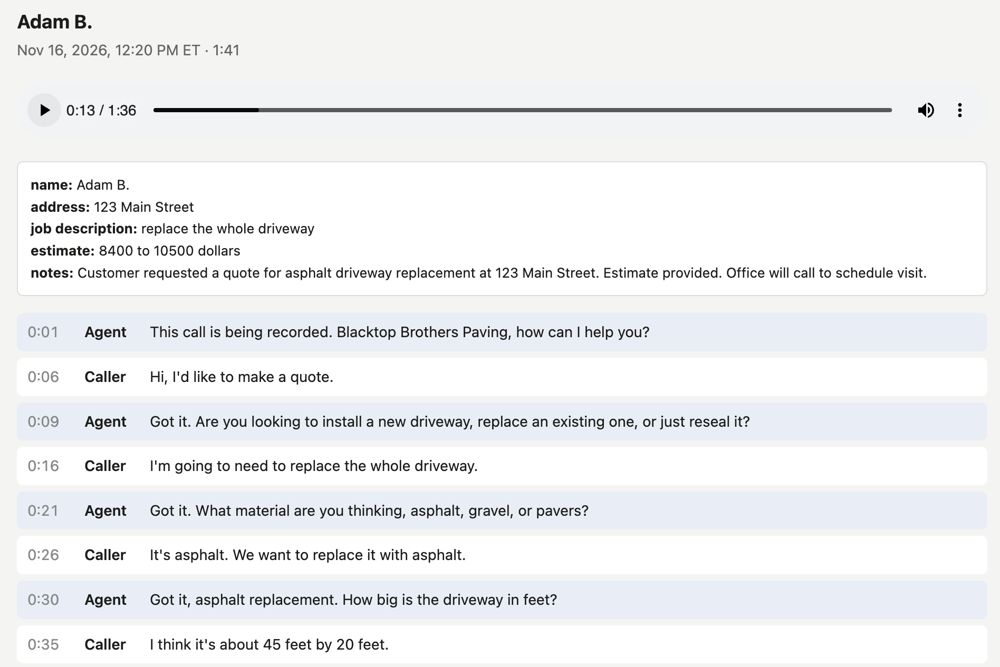

# Boson.ai - Higgs Phone Agent

Call a phone number and talk to an AI receptionist for a fictional paving company ("Blacktop Brothers Paving"). It gives ballpark driveway quotes, collects caller details, and remembers them for callbacks.

Admin can use the dashboard to review past calls. These are inbound inquiries for your business!



Twilio Media Streams (8 kHz μ-law) ↔ Node/Express bridge ↔ [Boson AI Higgs Realtime](https://docs.boson.ai/overview) (speech-to-speech over WebSocket).

## Accounts

- **Boson AI** (API key, prepaid credits): https://docs.boson.ai/overview
- **Twilio** (voice-capable phone number): https://www.twilio.com/try-twilio

## Requirements

- Node 24+
- A public HTTPS host proxying to the app port, with WebSocket support

## Setup

1. Install dependencies:
   ```bash
   npm install
   cp .env.example .env
   ```
2. Fill in `.env`:
   - `BOSON_API_KEY`
   - `PORT`
   - `ALLOWED_NUMBERS`: comma-separated E.164 caller numbers; all other numbers are rejected
   - `ADMIN_PASSWORD`, e.g. `openssl rand -base64 36`
3. Point a public HTTPS host at `localhost:$PORT`.
4. Twilio Console → Phone Numbers → your number → Voice Configuration → "A call comes in": **Webhook**, `POST`, `https://your.domain.com/voice`
5. Start the server:
   ```bash
   npm start
   ```
6. Call the number from a whitelisted phone.

## Admin

`https://your.domain.com/admin` (basic auth, `ADMIN_USER` / `ADMIN_PASSWORD`). The dashboard shows:

- The list of calls
- Each call's transcript and stereo recording; click a transcript line to seek the audio
- Saved customer info

Phone numbers are hidden for this demo.

## Files

| File | Purpose |
|---|---|
| `server.js` | Twilio webhook + media stream ↔ Higgs bridge (paced playback, barge-in, tool calls) |
| `prompt.js` | System prompt, greeting, pricing (`PRICES`, `MINIMUM_JOB`), `calculate_estimate` tool |
| `memory.js` | `customers.json` store keyed by caller ID; post-call detail extraction via Higgs |
| `recorder.js` | Writes `calls/<CallSid>.json` + `.wav` |
| `admin.js`, `admin.html` | Dashboard |

## Tuning

- **Voice:** `VOICE` env var (default `marcus`). Presets: https://docs.boson.ai/models/higgs-tts/voices.md
- **Speech detection:** `threshold` in `server.js`. 0.7 works for phone audio.
- **Reset caller memory:**
  ```bash
  echo '{}' > customers.json
  ```
